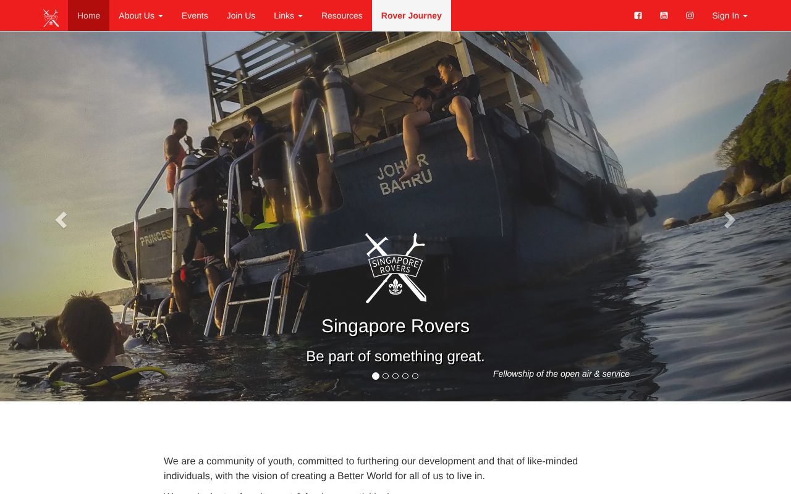
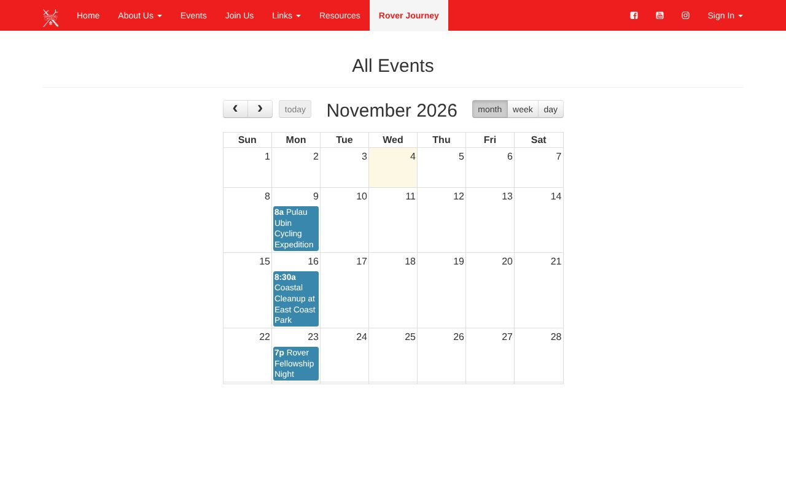
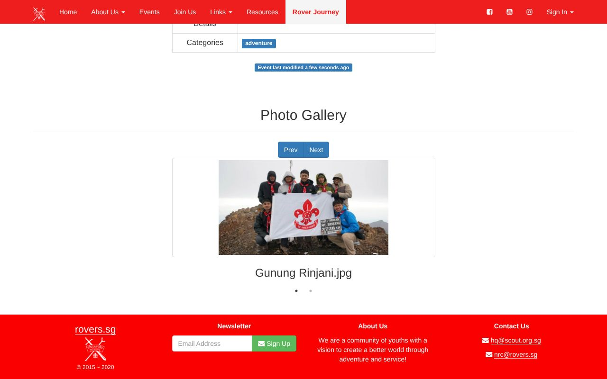
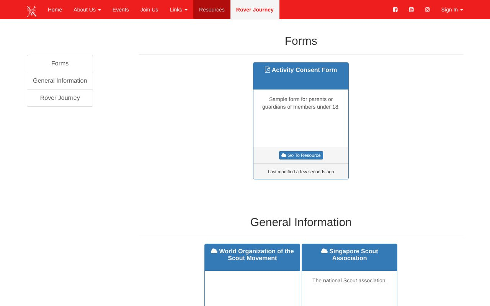
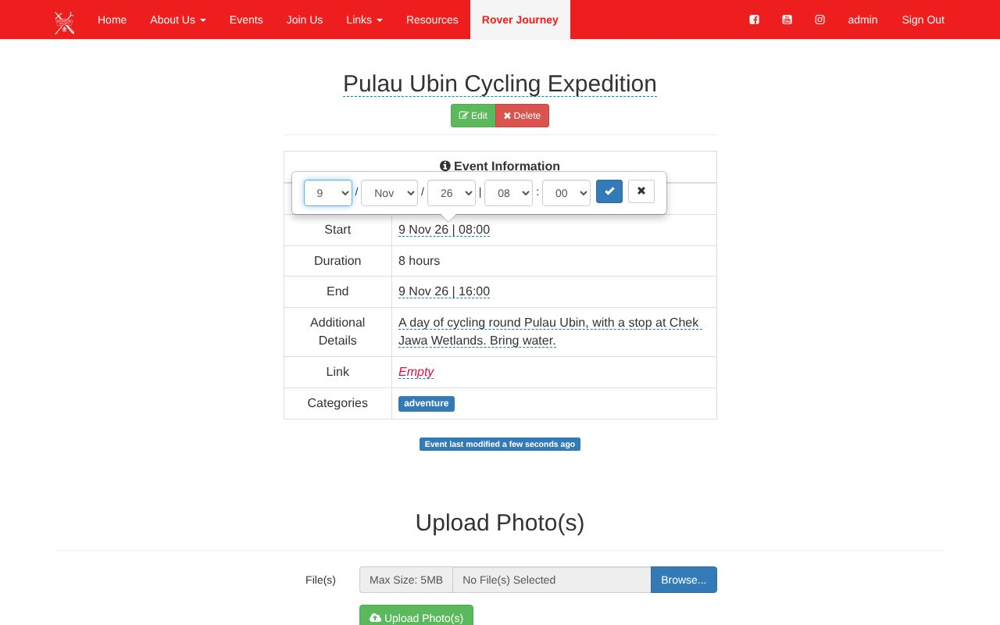
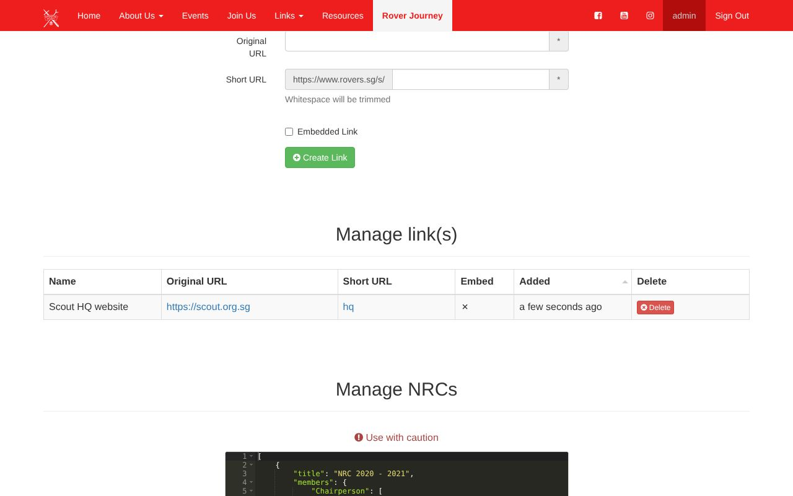

# rovers.sg

Website and content management system for the Singapore Rover Scouts: events with a calendar
and photo galleries, a resource library, a link shortener, and admin tools to manage them all.

**Demo:** [rovers-sg.onrender.com](https://rovers-sg.onrender.com). It runs on a free tier, so
the first visit can take a minute to wake up. Content is sample data, reset on every restart.

|                                                               |                                                               |
| ------------------------------------------------------------- | ------------------------------------------------------------- |
|                        |               |
|             |            |
|  |  |

## Features

- **Events:** upcoming events, a calendar, category pages, and photo galleries for past events.
- **Resources:** forms and information, as file downloads or links.
- **Admin:** create events, edit them in place, upload photos and resources, manage short links
  (`/s/<name>`), awardees and council members.

## Stack

Node.js and Express 5, server-rendered Handlebars templates, Bootstrap 3 and jQuery in the browser,
and NeDB (an embedded, file-based database), so it runs with no external services.

## Running locally

Requires Node.js 22.23.4 or newer.

```bash
npm ci
cp .env.example .env   # then set SESSION_SECRET (32+ characters) and an admin username/password
npm start              # http://localhost:5000
```

Set `SEED_DEMO_DATA=true` in `.env` to start with the sample content.

```bash
npm test               # HTTP tests
npm run test:browser   # click-through in headless Chromium (npx playwright install chromium)
npm run lint
```

---

Built in 2015, modernised in 2026.
